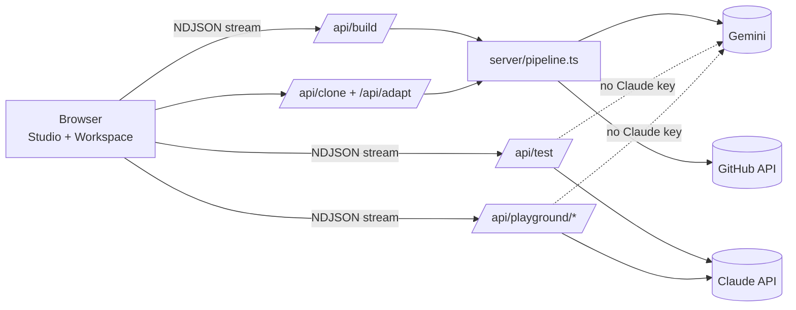

# Architecture

SkillForge is a single Next.js app. The browser talks to route handlers under `src/app/api/`, which call three outside services: **Gemini** (thinking and writing), **GitHub** (finding existing skills), and optionally **Claude** (running skills for real). Nothing is stored in a database yet; see [Roadmap](roadmap.md).

## The build pipeline

`POST /api/build` runs [`buildSkill()`](../src/server/pipeline.ts) and streams a progress event per step, so the UI can show the checklist live.

| Step | What happens | Code |
|---|---|---|
| 1. Analyze | Gemini turns the description into a kebab-case name, a one-line summary, search keywords and example trigger requests. | `analyzeDescription` in `ai/gemini.ts` |
| 2. Search | In parallel: GitHub code search for `SKILL.md` files matching the keywords (needs `GITHUB_TOKEN`), and Gemini with Google Search grounding listing GitHub URLs. Each URL is resolved to its `SKILL.md` files, whose frontmatter, stars and license are loaded. | `searchGithub`, `searchWebForSkills`, `candidatesFromUrl` |
| 3. Match | Gemini scores every candidate 0–100 against the request, with a reason. Candidates under 40 are dropped. | `scoreMatches` |
| 4. Clone | If the best **permissively licensed** match scores **85+**, its whole folder is downloaded and returned as-is. | `cloneSkill`, `fetchSkillFolder` |
| 5. Adapt | If it scores **60–84**, the folder is downloaded and Gemini makes the smallest changes that cover the request, returning the new files plus a list of what changed. License files are restored from the original if the model touched them. Falls back to generating if adapting fails or the skill is over 150,000 characters. | `adaptExisting`, `adaptSkill`, `keepLicenseFiles` |
| 6. Generate | Otherwise Gemini writes the skill from the spec in `skill-spec.ts`, with up to 5 found candidates as inspiration. Paths are cleaned; a wrapper folder Gemini sometimes adds is stripped. | `generateSkill`, `sanitize`, `stripWrapperFolder` |
| 7. Validate | Checks the result against the Agent Skill rules. A generated skill with errors gets one automatic repair pass by Gemini. | `validateSkill`, `repairSkill` |

The final result (`BuildResult` in [`types.ts`](../src/lib/types.ts)) holds the files, validation issues, all scored matches, the source repo when cloned or adapted, the list of changes when adapted, and example prompts for the playground.

Users can also pick any match from the Sources tab and choose **Use as-is** (`/api/clone`) or **Adapt to my request** (`/api/adapt`).

### Licensing rule

A skill is only cloned or adapted when its repo's SPDX license is one of MIT, Apache-2.0, BSD-2-Clause, BSD-3-Clause, ISC, Unlicense, CC0-1.0, 0BSD or MPL-2.0 (`PERMISSIVE` in `github.ts`). Others are shown as matches with "License doesn't allow copying or modifying". `/api/clone` and `/api/adapt` re-read the license from GitHub rather than trusting the browser.

Permissive licenses require keeping the copyright notice with copies, so when a skill folder has no license file of its own, the repo's root license is downloaded with it as `LICENSE`.

### Validation rules

Defined once in [`skill-spec.ts`](../src/lib/skill-spec.ts) and used both in Gemini's prompt and by [`validate.ts`](../src/lib/validate.ts):

- `SKILL.md` at the skill root, starting with YAML frontmatter
- `name`: lowercase letters, digits and single hyphens, at most 64 characters, without "claude" or "anthropic"
- `description`: present, at most 1024 characters, no `<` or `>`; warnings if it's very short or doesn't say when to use the skill
- Body present; warning above 500 lines
- Warning for any `scripts/`, `references/` or `assets/` path mentioned in `SKILL.md` that isn't in the skill
- No absolute paths or `..`

## Gemini: models and fallback

All Gemini calls go through `generate()` in [`gemini.ts`](../src/server/ai/gemini.ts), which tries `GEMINI_MODEL` and then each of `GEMINI_FALLBACK_MODELS`:

- **503 / 429** (overloaded, rate-limited): one retry after 2 seconds, then the next model
- **404** (model not offered to this key): straight to the next model
- **Too slow:** each model gets a time budget (45 s for small steps, 60 s for web search, 90 s for test cases, 150 s for generation). An overloaded model can crawl without erroring, so this matters. The last model in the list has no time limit.

Small steps use low thinking; skill writing and test cases use medium.

## Running skills: real vs simulated

Both "Try it" and graded tests check for `ANTHROPIC_API_KEY` (`simulated()` in `playground-sessions.ts`).

**With a Claude key**
- The skill is uploaded as a private custom skill (`client.skills.create`), then used via the Messages API with `container.skills` and the code execution tool, so Claude can load `SKILL.md` and run bundled scripts.
- Turns that pause (`stop_reason: "pause_turn"`) are continued in the same container.
- "Skill used" is detected when a code execution call reads `SKILL.md` or the skill's folder.
- Uploaded test skills are deleted afterwards (versions first, then the skill).
- Graded tests use `claude-opus-5-5` with server-side refusal fallback; the playground uses `claude-haiku-5-5`.

**Without a Claude key**
- Gemini gets all the skill's files in its system prompt and is told to behave like Claude with that skill installed. It can't execute scripts; it shows the command and works through the result.
- The UI labels these results **Simulated**.

Grading is always done by Gemini: it scores each answer 0–100 against the test case's criteria, and a test passes only if every criterion is met.

## Free playground

[`playground-sessions.ts`](../src/server/playground-sessions.ts) keeps sessions and usage in memory (on `globalThis`, so dev hot reloads don't wipe it).

- **Visitor identity:** an `sb_vid` httpOnly cookie plus a SHA-256 hash of the IP (`visitor.ts`). Limits apply to whichever key has used more, so clearing cookies alone doesn't reset them.
- **Limits:** session length, sessions per 24 hours, a hidden message cap per session, and a reply length cap. See [configuration](configuration.md).
- **History is append-only on the server.** The browser sends only the new message. Claude's full response content (including thinking and tool blocks) is appended unchanged, which keeps replayed thinking blocks valid and stops tampering.
- **Cleanup:** expired sessions are swept lazily on every playground request, deleting their uploaded skill. Closing the tab sends a beacon to `/api/playground/end`.

## Front end

- [`studio.tsx`](../src/features/studio/studio.tsx) is the state machine: **landing → building → workspace**, plus "missing" for unknown links. Finished builds are saved and the URL is replaced with `/skills/<id>` without a reload.
- [`workspace.tsx`](../src/features/workspace/workspace.tsx): header with actions, a "What we changed" card for adapted skills, file browser on the left, tabs on the right (Try it, Test, Sources, Checks). Tab panels stay mounted so a running chat or test survives switching.
- [`history.ts`](../src/lib/history.ts): up to 30 skills in `localStorage` under `skillforge:skills`. Opening a saved skill re-validates it and repairs the old nested-folder layout.
- Long operations stream newline-delimited JSON; [`ndjson.ts`](../src/lib/ndjson.ts) reads it on the client.
- Design tokens (colours for light and dark mode) live in [`globals.css`](../src/app/globals.css); components use them through Tailwind classes such as `bg-panel`, `text-muted` and `text-accent`.
